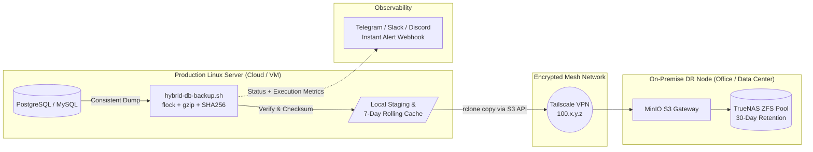

# Automated Hybrid Database & Object Storage Backup Pipeline
**Production-Grade Bash & Rclone Automation | PostgreSQL, MySQL, MinIO S3 & Tailscale Mesh**

A battle-tested, zero-dependency Bash backup pipeline engineered for Linux production servers. Designed to execute atomic database dumps (`PostgreSQL` & `MySQL/MariaDB`), verify archive integrity, optionally encrypt payloads via GPG, and synchronize backups across a hybrid cloud-to-on-premise storage topology (**MinIO / TrueNAS** over **Tailscale VPN**).

---

## 1. Architecture & Backup Topology

Instead of paying excessive cloud snapshot fees, this pipeline implements the **3-2-1 Backup Strategy** by bridging cloud/virtualized application servers with on-premise ZFS storage pools (**TrueNAS + MinIO**) over an encrypted WireGuard/Tailscale mesh network.



---

## 2. Key Engineering Features

* **Concurrency Lock (`flock`):** Prevents overlapping cron executions if a large database dump takes longer than expected or if the network link degrades.
* **Zero-Corruption Verification:** Generates a `SHA-256` manifest and tests archive integrity (`gzip -t`) prior to remote transfer. Corrupted dumps immediately halt execution and trigger an alert.
* **Tailscale Mesh Pre-Flight Check:** Automatically verifies that the on-premise MinIO storage node is reachable across the private Tailscale subnet before initiating `rclone` transfers.
* **Optional GPG At-Rest Encryption:** Supports symmetric AES-256 encryption (`--cipher-algo AES256`) before uploading to external S3 buckets.
* **Automated Dual-Tier Retention:** Independently prunes local staging disks (e.g., keep 7 days for rapid local restore) and remote MinIO/S3 buckets (e.g., keep 30–90 days for disaster recovery).
* **Instant Webhook Telemetry:** Pushes structured execution reports (Success/Failure, database size, duration, error line) to Telegram, Discord, or Slack.

---

## 3. Repository Structure

```text
.
├── README.md               # Architecture & operational documentation
├── hybrid-db-backup.sh     # Main production backup & sync engine
└── .env.example            # Configuration template
```

---

## 4. Quick Start & Setup

### Prerequisites
Ensure the following standard packages are installed on your Ubuntu/Debian host:
```bash
sudo apt-get update && sudo apt-get install -y postgresql-client mysql-client rclone gzip gnupg curl util-linux
```

### 1. Configure Rclone for On-Premise MinIO
Configure an `rclone` remote named `minio-onprem` pointing to your internal MinIO endpoint (accessible via Tailscale IP or local LAN):
```ini
# ~/.config/rclone/rclone.conf
[minio-onprem]
type = s3
provider = Minio
env_auth = false
access_key_id = YOUR_MINIO_ACCESS_KEY
secret_access_key = YOUR_MINIO_SECRET_KEY
endpoint = [http://100.](http://100.)x.y.z:9000
region = us-east-1
force_path_style = true
```

### 2. Configure Environment Variables
Copy `.env.example` to `.env` and lock down file permissions:
```bash
cp .env.example .env
chmod 600 .env
chmod +x hybrid-db-backup.sh
```

### 3. Schedule via Crontab
Run nightly at `01:30 AM` with automatic log rotation:
```cron
30 1 * * * /opt/backup-pipeline/hybrid-db-backup.sh /opt/backup-pipeline/.env >> /var/log/hybrid-backup.log 2>&1
```

---

## 5. Disaster Recovery (Restore Procedure)

### Verify Checksum & Decompress (PostgreSQL)
```bash
# 1. Pull latest backup from MinIO
rclone copy minio-onprem:production-db-backups/postgres/ /tmp/restore/ --max-age 24h

# 2. Verify SHA-256 integrity
cd /tmp/restore && sha256sum -c *.sha256

# 3. Restore to PostgreSQL
gunzip -c prod_db_2026-11-01_013000.sql.gz | psql -U postgres -h localhost -d target_database
```

---

## 6. Author & Infrastructure Consulting
Engineered and maintained by **Andriawan Maris** — Senior Full-Stack Engineer & Infrastructure Architect.
* **Email:** [mail@marisandriawan.my.id](mailto:mail@marisandriawan.my.id)
* **Specialization:** Linux System Administration, Hybrid Cloud Cost Optimization, Automated CI/CD & DevOps Pipelines.
